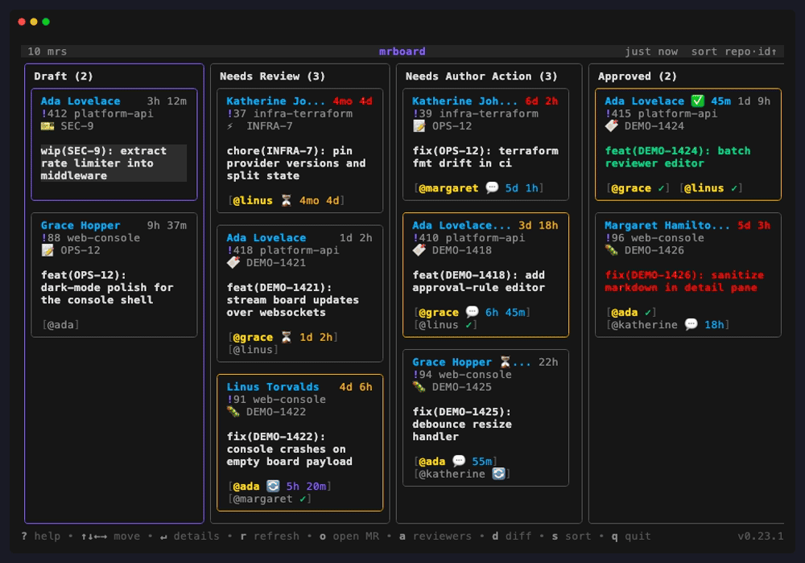

# mrboard

A terminal board for your team's GitLab merge requests — built for daily standups.



## Install

```bash
brew tap ceffo/tap
brew install mrboard
```

## Try it without a GitLab account

```bash
mrboard --demo
```

Runs the whole board against built-in fake data — no config file, no token, no network. Every
key works, including the reviewer editor and the diff view. Nothing is written to your cache
or state directories; writes only mutate the in-memory dataset.

## Quick start

Create `~/.config/mrboard/mrboard.yaml`:

```yaml
gitlab:
  url: https://gitlab.example.com
  token: glpat-xxx        # or set $GITLAB_TOKEN; needs api scope

sources:
  - type: group
    ids: [my-team]        # group paths, numeric IDs, or use type: user with usernames

current_user: alice       # highlights your MRs and enables the "my view" toggle
```

Then run `mrboard`. That's the whole required surface — everything else is optional.

Issue-tracker integration, Teams notifications, custom themes, external command launchers, and
the full list of settings with their defaults are documented in
[docs/configuration.md](docs/configuration.md).

## How the board works

Cards are grouped by whose turn it is, not by GitLab's merge status:

| Column | An MR lands here when |
| --- | --- |
| **Draft** | it is marked draft — this wins over everything else |
| **Needs Review** | reviewers still owe feedback |
| **Needs Author Action** | at least one reviewer has commented; the ball is with the author |
| **Approved** | every *designated approver* has approved |

The Approved column is about approvers specifically. An MR with no designated approvers stays
in Needs Review however many plain reviewers approve it — mark approvers in the reviewer editor
(`a`, then `space`). GitLab's `detailed_merge_status` doesn't decide the column; it only tints
an approved card green when it is genuinely mergeable and red when something still blocks it.

Each reviewer shows as a pill with their state:

| | |
| --- | --- |
| ⏳ | hasn't started, with how long they've been waiting |
| 💬 | left comments |
| 🔄 | re-review requested after changes |
| ✓ | approved |

With `current_user` set, **`tab`** toggles *my view*: every MR you authored, are assigned to, or
review (when an MR designates approvers, only its approvers count as reviewers). Independently of
the view, an unfocused card whose turn is yours gets a warning-colored border: you are the author or
assignee and a reviewer commented or the MR is ready to merge, or you are a reviewer who hasn't
started or was asked to re-review. Drafts never ask for attention.

Card ages turn amber after `lifetime_warn_after` (72h) and red after `lifetime_error_after`
(120h).

## Keys

Press **`?`** for every binding available in the current context — that modal is the source of
truth, and the footer always shows the most useful ones for where you are.

The four worth knowing up front: `↵` opens the detail pane, `d` the diff view, `a` the reviewer
editor, and `,` the settings panel.

`c` copies the selected MR's URL to the clipboard. Focus stops at the first and last card of a
column instead of wrapping around.

`L` (needs a Jira board in the config) swaps the board for the **review load** of the active sprint: the tree `mrboard load` prints,
with a selection on its MR lines (`↵`, `o`, `c` and `d` act on it as on a card). `g` groups by
person or ticket, `s` cycles the sort, `R` keeps only what is left to approve; all three are
remembered across sessions. `L` or `esc` returns to the board.

## CLI commands

Alongside the interactive board, `mrboard` has three one-shot commands for scripting and automation:

```bash
mrboard fetch    # fetch every configured MR and print it as JSON
mrboard load     # print the active sprint's review load per approver or ticket
mrboard auto     # run mrboard's automatic write actions once, outside the TUI
```

`fetch` mirrors exactly what the TUI fetches — same saved settings, same on-disk snapshot — and
never writes to GitLab. `--reviewer-mrs` overrides the saved "include reviewer-sourced MRs"
setting; `--cold` ignores the snapshots and caches and recomputes every MR from scratch.
`--merged-since YYYY-MM-DD` also lists the MRs merged on or after that day (`merged_at` set),
cached in a merged snapshot of their own, kept for that date only. Each MR carries its
review size (`review_size`, null when unknown, and `size_bucket`); `--verbose` adds the counted
and excluded files behind it.

`load` prints how much review size each approver carries in the active sprint (open MRs, plus MRs
merged since it started), as a tree. `--group person|jira`, `--sort person|jira|size` and
`--remaining` shape it and are never saved; the board's saved header filters apply unless
`--no-filters`; `--json` emits the computed rows; `--color auto|always|never`; `--view`,
`--reviewer-mrs` and `--cold` work as in `fetch`. It fails, rather than print a near-empty report,
when the board has no active sprint, the sprint has no issues or no start date, or the sprint
cannot be read. See [docs/adr/0015-review-load-view.md](docs/adr/0015-review-load-view.md).

`auto` runs mrboard's automatic write actions (currently: auto-assigning the team as reviewers
on newly opened, ticket-linked MRs — see `auto_assign_reviewers` in
[docs/configuration.md](docs/configuration.md)) as a standalone step, useful for a cron job when
nobody has the TUI open. It is a no-op unless `auto_assign_reviewers.enabled` is set. `--dry-run`
logs what would be assigned without writing to GitLab.

## Notifications

With a Teams webhook configured, `n` sends a notification about the focused MR to Teams. Set
`announce_approver_changes` and every running mrboard also announces approver changes it finds on
any MR, including ones made directly in GitLab; see [docs/configuration.md](docs/configuration.md).

## Updating

mrboard checks for a newer release on its own and tells you in the footer: an **`↑`** badge
appears next to the version number, and `u` opens a confirmation dialog that performs the
upgrade. The `u` binding only exists while an update is actually available.

To check and update without opening the board:

```bash
mrboard --update
```

That forces a fresh check, bypassing the cache, and upgrades in place if a newer release
exists — otherwise it prints `… is the latest release` and exits. Restart mrboard
afterwards to pick up the new version.

Either route runs the same thing, so you can also do it yourself:

```bash
brew update && brew upgrade ceffo/tap/mrboard
```

The check runs against the GitHub releases API, caches its answer for 24h, and never
blocks the board. Turn it off with:

```yaml
update_check:
  enabled: false
```

## Contributing

Build instructions, the architecture docs, and the release process are in
[docs/development.md](docs/development.md).
